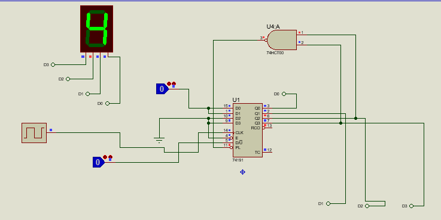
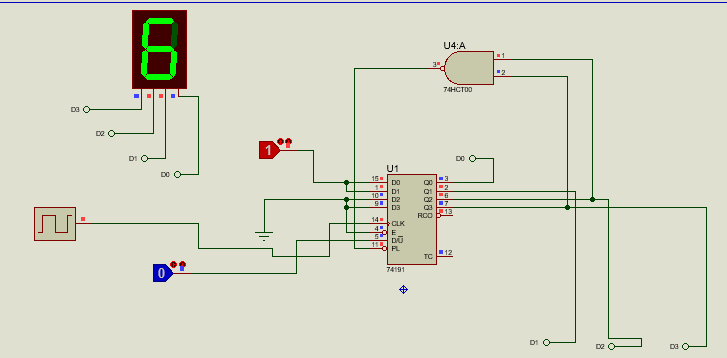
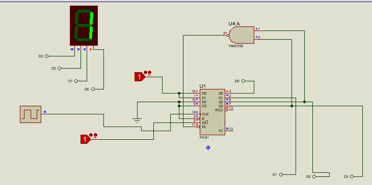

# Contador programable con 74191

Simulación en Proteus de un contador binario de 4 bits (74191) con carga
paralela. Puede contar hacia arriba o hacia abajo, y el valor de inicio se
elige con interruptores.

## CON LOGICSTATE 0 0

## CON LOGICSTATE 1 0

## CON LOGICSTATE 0 1

## CON LOGICSTATE 1 1

## Componentes
- 74191: contador binario síncrono arriba/abajo con carga paralela
- 74HCT00 (compuerta NAND): detecta cuándo recargar el contador
- Generador de pulsos como reloj
- Display de 7 segmentos para mostrar el valor en hexadecimal
- Logic states como interruptores de datos (D0-D3) y de sentido (D/Ū)

## Funcionamiento
1. El reloj avanza el contador un paso por pulso.
2. Las salidas Q0-Q3 se muestran en el display.
3. La NAND recibe Q3 y Q2. Cuando ambos valen 1, su salida baja a 0 y
   activa la entrada de carga paralela (PL) del 74191.
4. Al activarse PL, el contador copia a sus salidas el valor presente en
   D0-D3 y la cuenta continúa desde ahí.
5. Ese estado de paso (12 al subir, 15 al bajar) dura solo nanosegundos, por
   lo que no se ve en el display.

## Modos de funcionamiento
| Datos (D0-D3) | D/Ū | Comportamiento |
|---|---|---|
| 0000 | 0 (sube) | Cuenta 0 → 9 → A → B y vuelve a 0 |
| Valor N | 0 (sube) | Cuenta N → B y vuelve a N |
| Valor N | 1 (baja) | Cuenta N → 0 y vuelve a N |

Ejemplo con N = 3:
- Subiendo: 3, 4, 5, ..., A, B, 3, 4...
- Bajando: 3, 2, 1, 0, 3, 2...

## Por qué el último número es B al subir y 0 al bajar
- Al subir, el primer número con Q3 = Q2 = 1 es el 12 (1100), así que el
  último que se ve es el 11 (B).
- Al bajar, después del 0 el contador pasa al 15 (1111), que también tiene
  Q3 = Q2 = 1, así que el último que se ve es el 0.

## Nota sobre el valor de inicio
El circuito no guarda el valor: el 74191 lo lee de D0-D3 cada vez que se
activa la carga. Si cambias esos interruptores mientras cuenta, el valor nuevo
se carga en el siguiente reinicio.

Para que el comportamiento sea el descrito, el valor de inicio debe estar
entre 0 y 11.
